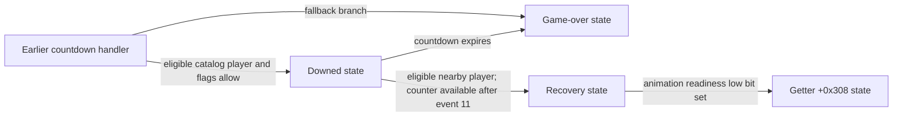

# Player revival and recovery

The player state machine now has a connected, partly executable reconstruction
of a downed/revival sequence. The strongest evidence is the original player
catalog, spatial checks, counter transfer, animation request, and state transitions.
"Revival", "group", and "counter" are descriptive research names. They do not
establish original method names or prove the counter's UI label (for example lives).

**Follow-up:** [Gameplay statistics](GAMEPLAY_STATISTICS.md) now ties the consumed
counter to life transfer using the original event wiring and `lifetakenbyplayer` /
`lifetakenfromplayer` strings. It also distinguishes a separate reanimation event.
The original field name and UI presentation are still not recovered.

There are **1,120 new bounded checks**: 753 interior revival-scan cases, 360 calls
through the complete 396-byte recovery handler, and seven calls through the
concrete exclusion query. Five mutated models are rejected. These are behavioral
checks with external effects stubbed, **not byte matches or full-game tests**.
Exact coverage is unchanged.

## Connected states

The primary `SPTG::ControllablePlayer` vtable is `0x1873c70`.

| Function | Slot | Observed role | Evidence in this batch |
| --- | --- | --- | --- |
| `0x9825d0 / 2948` | `+0x3a0` | Earlier countdown and choice of recovery/downed/game-over paths | Instruction/decompiler inspection only |
| `0x98d710 / 3324` | `+0x708` | Downed countdown, movement, proximity interactions | Revival scan tested; rest partially inspected or tested in earlier batch |
| `0x98e420 / 396` | `+0x718` | Recovery animation and restoration | Complete function, bounded fixtures |
| `0x98f270 / 484` | `+0x748` | Game-over coordination and `GameOverMovie` request | Previously tested; see PLAYER_ACTION_STATES |

Getters `+0x710` (`0x98e410`), `+0x720` (`0x98e5b0`), and `+0x750`
(`0x98f460`) return virtual member-pointer pairs `(0x708,1)`, `(0x718,1)`,
and `(0x748,1)`. The shared transition helper is `0x812930`.



The diagram is a partial map. The earlier handler also has a separate own-counter
recovery route through getter `+0x730`. Its base call, full entry conditions,
graphics callbacks, and alternate routes have not been reconstructed as a whole.
Its inspected catalog route selects the downed getter only when a catalog player's
virtual `+0x198` has a clear low bit and current-player bytes `+0x150c/+0x150d`
are both zero; it otherwise falls back to the game-over getter in that branch.
This is not proof that those are the only conditions for entering the downed state.

## Countdown configuration and entry

The original jump table at `0x1390dc0` maps events 10000/10001/10002/10003
to `0x98d764/0x98d830/0x98d92c/0x98e108` respectively.

On entry (10001), the downed handler clears both motion vectors, requests
animation 200 at rate 1 with flags `(1,0)`, copies the 32-bit value from player
`+0x12e8` to `+0x12e4`, and sets byte `+0x12ec` to 1. The copy/enable writes
are at `0x98d8a0..0x98d8ac`, with a base register already adjusted by `+0x78`.
It sets mode `+0x500` to 5 and PlayfieldActor byte **`+0x198`** to 1.
Exit clears that mode/flag. This is distinct from the action-state flag `+0x199`.

The serializer `0x978660 / 7352` passes these fields to stream virtual `+0x30`:

| Player offset | Transfer size | Observed use |
| --- | --- | --- |
| `+0x12e8` | 4 | Countdown initialization value |
| `+0x12ec` | 1 | Countdown enable byte |
| `+0x12f0` | 4 | Threshold for the graphics-event alternation path |
| `+0x12f4` | 4 | Divisor for that alternation path |

Calls occur at `0x979d18`, `0x979d40`, `0x979d70`, and `0x979d98`.
The serializer also copies `+0x12e8` into `+0x12e4` at `0x979d50..0x979d54`.
Thus the initialization value is part of the serialized player layout; this does
not recover the actual asset value, original field name, or complete file format.

The prior timer test covers update event 10000's near-zero test before subtraction
and numeric-max clamp. Expiry selects the game-over getter. See
[Player connections](PLAYER_CONNECTIONS.md) for floating-point edge cases.

## Revival scan: tested region

Entry is `0x98dd58`, with boundaries `0x98e104` (normal continuation) and
`0x98db20` (after transition call). It includes noncontiguous branches through
`0x98e1c4..0x98e250`; it is not a standalone original function.

1. Proceed only when player float `+0x1434` is strictly positive. Zero, negative,
   and NaN skip the scan.
2. Resolve the `ControllablePlayerCatalog`, own ActorObject and Transform.
3. Iterate in catalog order, skipping self and candidates whose virtual `+0x198`
   returns a set low bit. The concrete player query `0x96e4a0` returns `mode == 5`.
4. Compare absolute position differences against the **candidate's** reach fields
   `+0x300/+0x304/+0x308`. Equality is accepted; NaN comparisons reject.
   The actual comparison order is Y, X, Z.
5. Require equal 32-bit group fields at `+0x14e8`.
6. Dispatch event **11 to the candidate**, with that candidate as payload subject.
   Only then read its 32-bit counter at `+0x870`.
7. If nonzero, decrement with 32-bit wraparound, clear candidate byte `+0x510`,
   dispatch event **19 to the candidate**, event **20 to the recovering player**,
   and transition the latter through getter `+0x720`.

**The first spatial/group match stops the scan even if its counter is zero after
event 11.** It does not continue to a later player with an available counter.
The comparison harness explicitly tests both that ordering and callbacks that
turn a zero counter into a nonzero one, or consume the counter before the read.

Fixtures cover empty/self-only catalogs, rejected first entries, two-player order,
all three spatial axes and boundaries, infinities/NaNs, group mismatch, query low
bits, zero/nonzero/wrapping counters, and cached/missing-handle/missing-pointee
dependencies. Resolver and initializer calls are checked in order. Player memory,
event payloads, callback order, transition arguments, and stop boundary are compared.

## Recovery handler: complete-function checks

`0x98e420` handles the same four event IDs:

- **10001:** clear both motion vectors and request animation **201**, rate 1,
  flags `(0,0)`; return 1.
- **10000:** call readiness virtual `+0xd8`. With low bit clear, return 1.
  With low bit set, clear mode `+0x500`, copy float returns from `+0x1c8` and
  `+0x4b0` into `+0x160` and `+0x32c`, transition through getter `+0x308`, return 2.
- **10002/10003:** return 1 without these changes.
- **Other events:** return 0.

The readiness slot resolves to `0x93fc90`, the previously tested player animation
dependency wrapper. This connects recovery to the same unresolved runtime binding
for resolver ID `0x29fbe438`; it does not prove which concrete animation component
is installed. The restore getters are `0x97fb80` and `0x985320`. Their results use
**S0**, not W0; the decompiler's untyped integer-looking results are misleading.
The model carries their raw float bits without claiming those fields' original names.

## Reproduction and limits

```text
python tools/compare_player_revival.py --original <original.elf> --clang8 <clang++.exe> --build-dir <temporary-directory>
```

Source: [PlayerRevival.cpp](../src/wip/PlayerRevival.cpp).
Receipt: [player_revival_behavior.json](../progress/player_revival_behavior.json).

The scan starts with injected live registers after earlier movement/UI work;
those earlier conditions/effects are not covered by the scan tests. Catalogs,
object identities, and query results are stable. Event 11 may change only the
counter in these fixtures; events 19/20 and state-transition effects are stubbed.
Recovery tests use a warm zero-vector guard and stub external virtual methods.
No full-game execution, complete downed-handler recovery, or exact-match credit
is claimed. Original instructions and decompiler dumps remain private.

Next: reconstruct the earlier `0x9825d0` handler and event dispatch targets to
establish the counter's meaning, trace activation field `+0x1434`, and prove the
concrete animation dependency binding. These are remaining tasks, not results.
